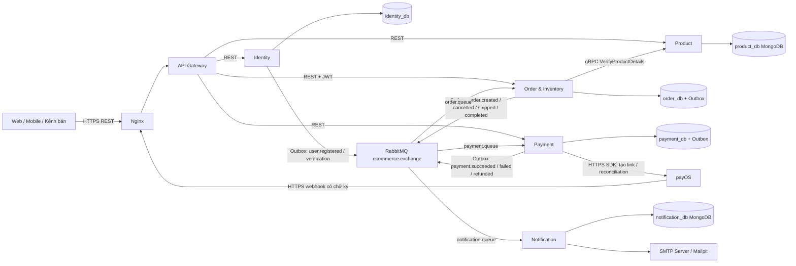

# Omnichannel E-Commerce Platform

Email xác minh tài khoản và thông báo đơn hàng dùng SMTP; Compose local dùng Mailpit, production yêu cầu cấu hình máy chủ SMTP. Xem [hướng dẫn email giao dịch](docs/email-delivery.md).

## 1. Tổng quan đề tài

**Tên đề tài:** Thiết kế, xây dựng và triển khai nền tảng thương mại điện tử đa kênh theo kiến trúc Microservices.

Nền tảng thương mại điện tử đa kênh, xây dựng bằng Java 17 và Spring Boot 4.1.1. Bài toán trọng tâm là tiếp nhận đơn hàng từ nhiều kênh dùng chung danh mục và tồn kho, tránh bán vượt số lượng khi flash sale, xử lý thanh toán bất đồng bộ và tiếp tục bán hàng khi dịch vụ thông báo gặp sự cố.

Trong doanh nghiệp, một thao tác đặt hàng liên quan nhiều nguồn dữ liệu và có thể thất bại từng phần. Dự án thực hành ranh giới nghiệp vụ, giao dịch cục bộ, Saga compensation và Transactional Outbox để giải quyết tình huống đó. Các kênh web, mobile và cửa hàng cần dùng chung nguồn dữ liệu để tránh lệch giá, tồn kho và trạng thái đơn. Microservices cho phép các nhóm phát triển và mở rộng từng nghiệp vụ độc lập; đổi lại, doanh nghiệp phải quản lý độ trễ, lỗi từng phần và tính nhất quán cuối cùng. Việc lựa chọn kiến trúc cần dựa trên quy mô và nhu cầu vận hành.

Phiên bản hiện tại cung cấp backend API, nhận thanh toán qua [payOS](docs/payos-integration.md) và gửi email giao dịch qua SMTP; chưa tích hợp sàn thương mại điện tử.

Chạy local từ thư mục gốc, cần Docker Compose v2 và Python 3.10+ cho demo; cần JDK 17 nếu chạy Gradle ngoài Docker:

Chế độ nhận tiền thật dùng PAYMENT_PROVIDER=payos và cấu hình theo [hướng dẫn payOS](docs/payos-integration.md). Các lệnh demo Day 13/14 bên dưới yêu cầu PAYMENT_PROVIDER=mock trên môi trường demo riêng.

```powershell
Copy-Item .env.example .env  # Chỉ thực hiện khi chưa có .env
# Đặt secret riêng trong .env trước khi chạy; không commit file này.
docker compose config --quiet
docker compose up -d --build --wait --wait-timeout 300
# Chuẩn bị ADMIN fixture và hai biến FIXTURE_ADMIN_* theo docs/security-and-cancellation.md
python infrastructure/day14/run-demo.py
```

Linux dùng `cp .env.example .env` và `python3`. Gateway ở `http://localhost:8080`, Grafana ở `http://localhost:3000`, Prometheus ở `http://localhost:9090`, và Mailpit Web UI ở `http://localhost:8025` (xem email xác thực và thông báo đơn hàng). Tài khoản Grafana lấy từ `.env`. Thư mục `test/postman/` cung cấp sẵn bộ sưu tập Postman hoàn chỉnh để kiểm thử API thủ công (xem [hướng dẫn Postman](test/postman/README.md)). Không chạy đồng thời hai file Compose local/production: chúng dùng chung tên container và volume.

## 2. Phân tích kiến trúc Microservices

| Service | Trách nhiệm thực tế | Dữ liệu sở hữu | Cổng trong Docker |
| --- | --- | --- | --- |
| API Gateway | Định tuyến REST đến service | Không có DB | 8080 |
| Identity | Đăng ký (xác minh email), đăng nhập, JWT, hồ sơ và kiểm tra ADMIN | PostgreSQL `identity_db` | 8081 |
| Product | CRUD sản phẩm, biến thể SKU, danh mục; xác minh SKU/giá qua gRPC; đồng bộ tồn ban đầu | MongoDB `product_db` | 8082 REST, 9090 gRPC |
| Order & Inventory | Đặt/hủy đơn, vòng đời giao hàng (CONFIRMED → SHIPPING → COMPLETED), giữ/trừ/hoàn tồn, tra cứu và điều chỉnh tồn kho theo SKU, Outbox | PostgreSQL `order_db` | 8083 |
| Payment | Mock hoặc payOS: tạo checkout, xác minh webhook, reconciliation và Outbox; hoàn tiền thật chưa tích hợp | PostgreSQL `payment_db` | 8084 |
| Notification | Nhận event RabbitMQ, lưu job vào MongoDB và gửi email giao dịch qua SMTP/Mailpit | MongoDB `notification_db` (collection `email_deliveries`) | 8085 |



### 2.1. Cơ chế giao tiếp

- **REST (HTTP/JSON):** client gọi Gateway; Gateway định tuyến tới các service. JWT/RBAC được kiểm tra tại service nghiệp vụ, Gateway hiện chủ yếu làm routing. Đường dẫn thực tế là `/api/...`; xem [API runtime](docs/api-runtime.md).
- **gRPC (HTTP/2, Protocol Buffers):** Order gọi `ProductGrpcService.VerifyProductDetails` để lấy SKU, tên và giá. Contract ở [product.proto](product-service/src/main/proto/product.proto); latency phải đo thực tế, không mặc định đạt dưới 5 ms.
- **Event-driven queue (RabbitMQ):** publisher đưa event từ Outbox vào topic exchange `ecommerce.exchange`; các queue `payment.queue`, `order.queue`, `notification.queue` tách công việc của từng consumer. Retry/phát lại đòi hỏi xử lý idempotent, xác nhận message và theo dõi backlog.

Service chỉ truy cập DB của mình. PostgreSQL có thể dùng chung một container cho demo nhưng các database tách biệt. Redis có trong stack; giữ tồn hiện được bảo vệ bằng **SQL UPDATE có điều kiện trong transaction PostgreSQL**, không dùng Redis lock. Dữ liệu tồn có thẩm quyền nằm ở Order & Inventory; trường `stock` của catalog chỉ là tồn ban đầu khi tạo sản phẩm, không thay thế kiểm tra tồn khi đặt hàng và không bị ghi đè khi cập nhật thông tin sản phẩm (PUT product). ADMIN xem tồn qua `GET /api/inventory` hoặc `GET /api/inventory/{sku}`, nhập/giảm tồn bằng `POST /api/inventory/{sku}/adjustments` với `quantityDelta` có dấu. Vòng đời đơn hàng sau thanh toán được quản lý chặt chẽ: ADMIN chuyển trạng thái giao hàng qua `POST /api/orders/{id}/ship` (CONFIRMED → SHIPPING), và khách hàng xác nhận nhận hàng qua `POST /api/orders/{id}/confirm-receipt` (SHIPPING → COMPLETED); các bước này đều phát sự kiện gửi email tương ứng. Xem [hợp đồng và ví dụ API](docs/api-runtime.md).

```mermaid
sequenceDiagram
    actor User
    participant G as Gateway
    participant I as Identity
    participant P as Product
    participant O as Order & Inventory
    participant Q as RabbitMQ
    participant Pay as Payment
    participant Provider as payOS
    participant N as Notification
    User->>G: Register / Login
    G->>I: REST
    I-->>User: JWT access token + emailVerified (qua Gateway)
    Note over I,N: Đăng ký phát event để N gửi link xác minh email 24h
    User->>G: GET product; POST order + Bearer JWT
    G->>P: GET product
    G->>O: POST /api/orders
    O->>P: gRPC VerifyProductDetails
    P-->>O: SKU, tên và giá có thẩm quyền
    O->>O: Transaction: giữ tồn + PENDING + Outbox (kèm email snapshot)
    O-->>User: HTTP 201 (qua Gateway)
    O->>Q: Outbox publisher: OrderCreatedEvent
    Q->>Pay: payment.queue
    alt PAYMENT_PROVIDER=mock (demo)
        Pay->>Pay: Transaction: kết quả mock + Outbox
    else PAYMENT_PROVIDER=payos
        Pay->>Pay: Lưu payment PENDING và payment intent
        Pay->>Provider: Worker tạo checkout link sau commit
        User->>G: GET /api/payments/{orderId} + JWT
        G->>Pay: Lấy checkoutUrl / QR
        User->>Provider: Thanh toán qua checkout
        Provider->>G: Webhook có chữ ký
        G->>Pay: Chuyển webhook
        Pay->>Pay: Xác minh chữ ký, số tiền, mã link; lưu kết quả + Outbox
        Note over Pay,Provider: Worker reconciliation khi webhook bị thất lạc
    end
    alt Thanh toán thành công
        Pay->>Q: PaymentSucceededEvent
        Q->>O: CONFIRMED, trừ tồn và giải phóng reservation
    else Thanh toán thất bại
        Pay->>Q: PaymentFailedEvent
        Q->>O: CANCELLED, hoàn tồn, ghi Outbox
        O->>Q: OrderCancelledEvent
    end
    Q->>N: Các event qua notification.queue
    N->>N: Lưu job vào MongoDB (dedup theo eventId) & gửi email qua SMTP
    Note over Q,N: Nếu N dừng, durable queue giữ message để xử lý khi N chạy lại
```

HTTP 201 chỉ xác nhận đã tạo đơn. Client đọc lại trạng thái đơn để biết Saga hoàn tất. Publisher dùng batch và publisher confirms; consumer phải chịu được phát lại message. Payment chống tạo trùng theo `orderId`; Order kiểm soát trạng thái; Notification lưu trữ job trong MongoDB với unique index theo `eventId` để chống gửi trùng email.

## 3. Hướng dẫn tìm hiểu và phân tích hệ thống

1. Đọc [quy ước code](CODING_CONVENTION.md), [SRS](docs/srs.md) và [timeline](docs/timeline-2weeks.md). Phân biệt yêu cầu mục tiêu với chức năng đã triển khai trong [API thực tế](docs/api-runtime.md).
2. Phân tích DDD: xác định actor Customer/Admin; các bounded context Identity, Catalog, Order/Inventory, Payment, Notification. Liệt kê command, event, invariant và chủ sở hữu dữ liệu trước khi thiết kế bảng.
3. Với Order aggregate, viết trạng thái `PENDING → CONFIRMED / CANCELLED`, điều kiện giữ tồn và tình huống payment thất bại. Đặt invariant `total_stock = available_stock + reserved_stock`, các số không âm, số lượng đã bán không vượt tồn ban đầu. Khách chỉ được hủy PENDING; trạng thái khác trả 409. Payment lưu dấu hủy và bù trừ thanh toán thành công đến muộn theo [luồng hủy đơn](docs/security-and-cancellation.md).
4. Thiết kế dữ liệu theo service: User; Product/Category/Variant document; Order/OrderItem/Inventory/StatusHistory; Payment; Outbox. Dùng `BigDecimal` cho tiền trong thiết kế; chụp tên/giá vào order item để thay đổi catalog không làm đổi đơn cũ. Không tạo foreign key xuyên database.
5. Thiết kế REST bằng DTO/validation/status code và quyền truy cập; gRPC contract ở `product-service/src/main/proto/product.proto`; envelope event có `eventId`, `eventType`, `timestamp`, `data` theo [event contract](docs/event_vi.md). Ghi trạng thái và Outbox trong cùng transaction.
6. Theo dõi một orderId qua Order → Outbox → RabbitMQ → Payment → Order → Notification. Thử thiếu tồn, token sai, lỗi payment, service dừng và phát lại event. Đối chiếu dữ liệu nghiệp vụ sau khi queue đã xử lý xong.
7. Đọc [tối ưu hiệu năng](docs/performance-optimization.md), đo bằng [k6 Day 13](docs/day13-monitoring-load-test.md), rồi chạy [nghiệm thu Day 14](docs/day14-final-demo.md). Đánh giá latency, throughput và tính đúng đắn riêng biệt.

Để chạy test/build phần giao dịch bằng JDK 17 và PostgreSQL tạm:

```powershell
python -m unittest discover -s infrastructure/day14 -p "test_*.py"
python -m unittest discover -s infrastructure/k6 -p "test_*.py"
python infrastructure/postgres/run-performance-tests.py --services order-inventory-service payment-service
```

Các service khác dùng Gradle wrapper `test bootJar` trong thư mục service. Product integration test cần MongoDB test riêng; không dùng DB catalog đang demo. [CI](.github/workflows/ci.yml) mô tả môi trường test từng service.

### 3.1. Sản phẩm đầu ra khi phân tích DDD và dữ liệu

| Bước | Công việc | Tài liệu cần bàn giao |
| --- | --- | --- |
| Khảo sát nghiệp vụ | Xác định Customer/Admin, kênh bán, vòng đời đơn và trường hợp lỗi | Use case, thuật ngữ chung, sơ đồ event storming |
| Chia domain | Xác định bounded context, aggregate root và invariant | Context map; bảng trách nhiệm và quyền sở hữu dữ liệu |
| Thiết kế database | ERD riêng cho từng SQL database; document schema cho catalog; index/unique constraint | Schema, migration, quy tắc snapshot giá, lưu trữ và backup |
| Thiết kế contract | REST method/path/DTO/status/auth; protobuf; event envelope/routing | OpenAPI, `.proto`, event catalog và quy tắc versioning |
| Thiết kế nhất quán | Transaction cục bộ, giữ tồn có điều kiện, Outbox, Saga compensation, idempotency | Sequence diagram thành công/thất bại và ma trận retry/timeout |
| Nghiệm chứng | Kiểm thử quyền, concurrency, rollback, event trùng và service dừng | Test report, dữ liệu đối chiếu, hạn chế còn tồn tại |

API contract cần ghi rõ 401/403, validation, trạng thái xung đột, quyền sở hữu đơn và cách client xử lý PENDING. Khi thay đổi protobuf, không tái sử dụng field number đã bỏ. Event version mới phải tương thích consumer đang chạy; không giả định queue chỉ giao đúng một lần. Outbox không tạo một transaction chung giữa PostgreSQL và RabbitMQ: transaction chỉ bao phủ dữ liệu nghiệp vụ cùng bản ghi Outbox; publisher gửi sau commit và có thể phát lại.

## 4. Hướng dẫn triển khai lên VPS thực tế

### 4.1. Chuẩn bị Ubuntu và Docker

Dùng Ubuntu 22.04/24.04 LTS, cấu hình khởi đầu cho demo **4 vCPU, 8 GB RAM, SSD 50 GB**, domain trỏ A/AAAA đúng VPS và tài khoản SSH có sudo. Đây là cấu hình tham khảo; đo RAM, disk và tải thực tế trước khi đặt mục tiêu phục vụ. VPS chạy image không cần cài JDK.

```bash
sudo apt update
sudo apt install -y ca-certificates curl git nginx ufw python3 snapd
```

Thiết lập apt repository theo [Docker Engine chính thức cho Ubuntu](https://docs.docker.com/engine/install/ubuntu/#install-using-the-repository), rồi cài:

```bash
sudo apt install -y docker-ce docker-ce-cli containerd.io docker-buildx-plugin docker-compose-plugin
sudo systemctl enable --now docker nginx
sudo docker run --rm hello-world
sudo usermod -aG docker "$USER"
# Đăng xuất/đăng nhập lại trước khi dùng Docker không có sudo.
docker compose version
```

Mở đúng cổng SSH trước khi bật UFW và kiểm tra bằng phiên SSH thứ hai. Ví dụ với SSH cổng 22:

```bash
sudo ufw allow 22/tcp
sudo ufw allow 80/tcp
sudo ufw allow 443/tcp
sudo ufw default deny incoming
sudo ufw default allow outgoing
sudo ufw enable
```

Áp dụng chính sách tương ứng trên firewall nhà cung cấp. Docker published ports có thể vượt UFW: dùng Compose production với binding loopback và kiểm tra từ máy ngoài. Không mở public PostgreSQL, MongoDB, Redis, RabbitMQ hay bảng điều khiển monitoring.

### 4.2. Repository, cấu hình và Docker Compose

```bash
sudo install -d -o "$USER" -g "$(id -gn)" /opt/omnichannel-ecommerce
git clone https://github.com/vanh251/OMNICHANNEL-E-COMMERCE-PLATFORM.git /opt/omnichannel-ecommerce
cd /opt/omnichannel-ecommerce
# Chỉ tạo khi chưa có file cấu hình local.
if [ ! -e .env ]; then cp .env.example .env; fi
chmod 600 .env
```

Thay password mẫu và `JWT_SECRET` trong `.env`, giữ cùng JWT secret giữa Identity/Order/Product/Payment; không commit secret. Giữ hostname Docker và cổng nội bộ mặc định. Các database khởi tạo là `identity_db`, `order_db`, `payment_db`; init SQL chỉ chạy trên volume rỗng. Thay `.env` không tự đổi mật khẩu của database đã có dữ liệu.

Đặt `IMAGE_PREFIX=ghcr.io/vanh251/omnichannel` (đổi owner nếu fork) và `IMAGE_TAG=sha-<7-ký-tự-commit-đã-build>`. Chạy workflow **Docker Build & Push** để có đủ sáu image. Với package private, dùng `docker login ghcr.io` và token có quyền đọc package qua prompt.

- Demo/load test: `PAYMENT_PROVIDER=mock`, sử dụng môi trường riêng.
- payOS: `PAYMENT_PROVIDER=payos`, cấu hình `PAYOS_CLIENT_ID`, `PAYOS_API_KEY`, `PAYOS_CHECKSUM_KEY` và return/cancel/webhook URL theo [hướng dẫn tích hợp](docs/payos-integration.md). Không dùng giao dịch tiền thật để chạy k6 hoặc runner mock.
- Email/SMTP (bắt buộc trên production Compose): cấu hình `EMAIL_VERIFICATION_BASE_URL` (URL Gateway public, ví dụ `https://api-vanhdz.duckdns.org`), `MAIL_HOST`, `MAIL_PORT`, `MAIL_USERNAME`, `MAIL_PASSWORD`, `MAIL_FROM` theo [hướng dẫn email giao dịch](docs/email-delivery.md).

> [!TIP]
> **Bảo trì dung lượng ổ đĩa VPS:** Trước khi kéo image mới trên VPS có phân vùng ổ đĩa hạn chế (ví dụ 20 GB), hãy kiểm tra `df -h /`. Nên chạy `docker system prune -af` để dọn dẹp image cũ và build cache, tránh lỗi thiếu dung lượng (`no space left on device`) trong quá trình deploy.

```bash
docker compose -f docker-compose.production.yml config --quiet
docker compose -f docker-compose.production.yml pull
docker compose -f docker-compose.production.yml up -d --wait --wait-timeout 300
docker compose -f docker-compose.production.yml ps
curl -fsS http://127.0.0.1:8080/actuator/health
```

Khi lỗi, đọc `docker compose -f docker-compose.production.yml logs --tail=100 <service>`. Không chạy cùng lúc stack local và production vì dùng chung tên container/volume. Không dùng `down -v` để chữa lỗi; volume chứa dữ liệu. Xem [hướng dẫn VPS chi tiết](docs/day14-vps-deployment.md) về lưu trữ, backup và quyền truy cập.

### 4.3. Nginx Reverse Proxy và SSL Certbot

```bash
sudo cp infrastructure/nginx/omnichannel.conf /etc/nginx/sites-available/omnichannel
sudo nano /etc/nginx/sites-available/omnichannel
```

Đổi `server_name` trong mẫu thành domain của bạn. Mẫu proxy `/api/` tới `http://127.0.0.1:8080`, giữ URI và forward header; các đường dẫn khác trả 404 để không công khai Actuator. Nếu demo giới hạn IP, thêm allowlist tại `/api/`; giữ endpoint webhook payOS và thử thách ACME truy cập được. Webhook công khai vẫn bắt buộc chữ ký hợp lệ.

```bash
# Chỉ tạo symlink nếu chưa tồn tại.
sudo ln -s /etc/nginx/sites-available/omnichannel /etc/nginx/sites-enabled/omnichannel
sudo nginx -t
sudo systemctl reload nginx
# Thay api.example.com bằng domain thực, DNS và cổng 80 phải hoạt động.
sudo snap install --classic certbot
sudo /snap/bin/certbot --nginx -d api.example.com --redirect
sudo /snap/bin/certbot renew --dry-run
curl -f https://api.example.com/api/products
```

Kiểm tra HTTP chuyển sang HTTPS, certificate đúng domain, gia hạn tự động và `/actuator/prometheus` trả 404 từ Internet. Đổi cả URL payOS trong cấu hình/workflow nếu dùng domain khác mẫu hiện có. Tham khảo [Certbot](https://certbot.eff.org/).

### 4.4. CI/CD GitHub Actions và rollback

| Workflow | Công việc |
| --- | --- |
| [CI](.github/workflows/ci.yml) | Test service, test PostgreSQL và kiểm tra cấu hình hạ tầng |
| [Docker Build & Push](.github/workflows/docker.yml) | Build sáu image và đẩy GHCR với `latest`, `sha-<7 ký tự>` |
| [Deploy Production](.github/workflows/deploy.yml) | Sau build main thành công hoặc chạy thủ công trên main: SSH, checkout commit build, chọn image SHA, cập nhật payOS, pull/up và kiểm tra HTTPS/webhook |

Cấu hình Actions secrets `VPS_HOST`, `VPS_USER`, `VPS_SSH_KEY`, `VPS_PORT`; workflow deploy hiện cũng cần ba secret payOS nêu trên. SSH user cần quyền Docker và quyền đọc repository/GHCR không tương tác. Bật branch protection yêu cầu CI đạt; workflow build chạy độc lập nên build thành công chưa chứng minh test thành công.

Workflow chờ toàn stack healthy và trả lỗi nếu HTTPS/webhook chưa đạt; không tự rollback. Lưu commit, image tag và backup trước deploy. Khi rollback, dùng cấu hình tương thích, đặt `IMAGE_TAG` về tag đã nghiệm thu rồi `pull`/`up --wait`. Rollback image không khôi phục database; cần diễn tập backup/restore và migration tương thích.

### 4.5. Monitoring: Prometheus, Grafana, Loki và Alloy

Stack đã có sẵn:

- [Prometheus](infrastructure/prometheus/prometheus.yml) scrape `/actuator/prometheus` của sáu service mỗi 15 giây.
- [Grafana provisioning](infrastructure/grafana/provisioning/datasources/datasources.yml) khai báo datasource Prometheus/Loki; [dashboard](infrastructure/grafana/dashboards/ecommerce-overview.json) hiển thị tình trạng service và số liệu ứng dụng.
- [Grafana Alloy](infrastructure/alloy/config.alloy) thu log container và đẩy vào [Loki](infrastructure/loki/loki.yml). Cấu hình hiện tại dùng Alloy; không cần thêm Promtail.

Truy cập bảng điều khiển qua SSH tunnel từ máy cá nhân:

```bash
ssh -p <ssh-port> -L 3000:127.0.0.1:3000 -L 9090:127.0.0.1:9090 -L 15672:127.0.0.1:15672 <user>@<vps>
```

Mở Grafana ở localhost:3000, Prometheus `/targets` ở localhost:9090 và RabbitMQ ở localhost:15672. Xác nhận sáu targets UP, dashboard có RPS/p95/error rate khi tạo tải và Loki tìm được log theo orderId. CPU/RAM toàn host/container cần exporter tương ứng nếu muốn đo ngoài metrics JVM hiện có. Thiết lập cảnh báo service down, backlog tăng, lỗi 5xx và disk gần đầy; xem [hướng dẫn monitoring và PromQL](docs/day13-monitoring-load-test.md).

VPS/HTTPS, deploy remote và giao dịch payOS thực phải được nghiệm thu riêng; kết quả local không thay thế bằng chứng trên máy thật.

## 5. Tiêu chí đánh giá và yêu cầu bài làm

| Nhóm | Tiêu chí nghiệm thu / bằng chứng |
| --- | --- |
| Chức năng | Register/Login/JWT và xác minh email; CRUD catalog; tra cứu/điều chỉnh tồn kho; POST order → payment SUCCESS → CONFIRMED → giao hàng (SHIPPING → COMPLETED) → email Notification đúng orderId |
| Flash sale | Tồn 10; 500 worker cùng qua barrier, mỗi worker gửi 1 POST; đúng 10 HTTP 201, 490 lỗi thiếu tồn; 0 lỗi bất thường; 10 CONFIRMED; total/available/reserved đều 0 |
| Compensation | Mock amount > 10000 → FAILED → CANCELLED; stock trở lại ban đầu, reserved = 0 |
| Chịu lỗi | Stop Notification; order/payment vẫn thành công; queue giữ event; start lại, đủ email trong Mailpit và queue về 0 |
| Nhất quán | Test stock concurrency, rollback và Outbox trên PostgreSQL; trạng thái và event cùng transaction; kiểm tra hành vi khi message phát lại |
| Hiệu năng | Báo cáo target/achieved RPS, p95, lỗi và dropped iterations. Mục tiêu Day 13 p95 < 2000 ms, lỗi < 1%, không bỏ iteration; không tính lỗi hết hàng chủ đích của flash sale là lỗi tải thông thường |
| Vận hành | Compose healthy; API qua HTTPS thật; TLS renewal thử thành công; chỉ mở SSH/HTTP/HTTPS; kiểm tra từ máy ngoài; Prometheus targets UP, dashboard Grafana và logs Loki |
| Bài nộp | Source và test/build; README, architecture/sequence diagram, API/event contract; JSON kết quả demo; kết quả k6; bằng chứng VPS/HTTPS/CI/monitoring và danh sách hạn chế |

### 5.1. Chỉ số đo lường và cách chấm

Báo cáo phải ghi cấu hình máy, commit/image tag, dữ liệu ban đầu, thời gian chạy và tải mục tiêu so với tải đạt được. Tách latency HTTP tạo đơn khỏi thời gian hoàn tất Saga. Với bài test tải bình thường, báo cáo p50/p95/p99, throughput, error rate, dropped iterations, CPU/RAM và queue backlog; với flash sale, đo số đơn được chấp nhận cùng invariant tồn kho. 500 worker đồng thời không đồng nghĩa 500 requests/giây.

Gợi ý thang điểm: kiến trúc và DDD **20%**, chức năng/API/bảo mật **25%**, nhất quán và chịu lỗi **25%**, VPS/CI/CD/monitoring **20%**, tài liệu và demo **10%**. Mục tiêu tải 500–1000 RPS là mục tiêu bài tập cần có bằng chứng đo, không phải cam kết hệ thống hiện đã đạt.

### 5.2. Kịch bản demo bắt buộc

1. **Luồng thành công:** đăng ký/đăng nhập (xác minh email qua token một lần), ADMIN tạo sản phẩm và quản lý tồn qua API Inventory, khách tạo đơn; theo dõi payment, CONFIRMED, giao hàng (SHIPPING → COMPLETED) và email thông báo tương ứng.
2. **Flash sale:** tồn 10, 500 worker qua barrier; trình bày 10 đơn được chấp nhận, 490 lỗi thiếu tồn và đối chiếu số tồn sau Saga.
3. **Thanh toán thất bại:** trên mock, amount > 10000 dẫn tới FAILED/CANCELLED; tồn được hoàn và reserved về 0.
4. **Sự cố Notification:** dừng service, chứng minh Order/Payment vẫn xử lý; khởi động lại, chứng minh queue được tiêu thụ và email xuất hiện trong Mailpit.
5. **Bảo mật và phát lại:** token thiếu/sai, người khác đọc payment, khách ghi catalog; đối chiếu 401/403 và quyền ADMIN. Phát lại event để kiểm tra không trừ kho/thu tiền lần hai; kiểm tra cơ chế dedup Notification qua unique eventId.
6. **Vận hành:** truy cập API bằng domain HTTPS, lần CI/deploy thành công, dashboard metric/log, chứng chỉ và kiểm tra cổng từ máy ngoài.
7. **payOS nếu chọn nghiệm thu tích hợp:** tạo checkout với số tiền nhỏ đã thống nhất, xác minh webhook/Saga; chứng minh return URL hoặc webhook sai chữ ký không thể tự xác nhận thanh toán. Ghi rõ hoàn tiền thật chưa hỗ trợ.

```bash
# Cần PAYMENT_PROVIDER=mock và ADMIN fixture theo tài liệu bảo mật.
python3 infrastructure/day14/run-demo.py
python3 infrastructure/k6/run-load-test.py --rates 500 1000 --duration 30
```

Demo bắt buộc: chạy runner Day 14, trình bày 10/490 và đối chiếu tồn; trình bày compensation; dừng/khôi phục Notification; mở dashboard/log theo orderId; truy cập domain HTTPS và trình bày lần deploy thành công. Runner tạo SKU/user riêng, giữ fixture để xem lại và tự khởi động lại Notification trong `finally` khi gặp lỗi; chỉ dùng trên môi trường demo không có khách hàng thật.

Kết quả local lịch sử đã ghi tại [biên bản Day 14](docs/day14-final-demo.md); chưa chạy lại nghiệm thu tích hợp sau khi thêm SMTP. Còn thiếu nghiệm thu VPS/HTTPS và gửi email đến hộp thư thật. [Kết quả tải sau tối ưu Day 13](docs/performance-optimization.md) vẫn chưa đạt mục tiêu p95/throughput. Product/Payment đã có JWT/RBAC và kiểm tra chủ payment; xem [hướng dẫn cập nhật và tài khoản ADMIN fixture](docs/security-and-cancellation.md). payOS đã có tạo link, webhook và reconciliation; hoàn tiền thật/chi hộ chưa tích hợp. Refresh endpoint và pagination chưa hoàn chỉnh; không xem toàn bộ SRS hay production readiness là đã đạt.
