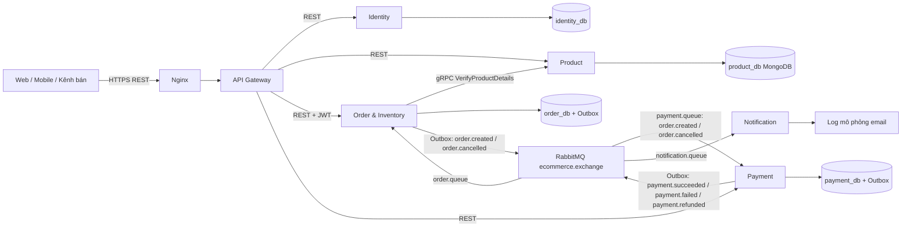

# Omnichannel E-Commerce Platform

## 1. Tổng quan đề tài

Nền tảng thương mại điện tử đa kênh, xây dựng bằng Java 17 và Spring Boot 4.1.1. Bài toán trọng tâm là tiếp nhận đơn hàng từ nhiều kênh dùng chung danh mục và tồn kho, tránh bán vượt số lượng khi flash sale, xử lý thanh toán bất đồng bộ và tiếp tục bán hàng khi dịch vụ thông báo gặp sự cố.

Trong doanh nghiệp, một thao tác đặt hàng liên quan nhiều nguồn dữ liệu và có thể thất bại từng phần. Dự án thực hành ranh giới nghiệp vụ, giao dịch cục bộ, Saga compensation và Transactional Outbox để giải quyết tình huống đó. Phiên bản hiện tại cung cấp backend API và nhận thanh toán qua [payOS](docs/payos-integration.md); chưa tích hợp sàn thương mại điện tử hay email thật.

Chạy local từ thư mục gốc, cần Docker Compose v2 và Python 3.10+ cho demo; cần JDK 17 nếu chạy Gradle ngoài Docker:

Chế độ nhận tiền thật dùng PAYMENT_PROVIDER=payos và cấu hình theo [hướng dẫn payOS](docs/payos-integration.md). Các lệnh demo Day 13/14 bên dưới yêu cầu PAYMENT_PROVIDER=mock trên môi trường demo riêng.

```powershell
Copy-Item .env.example .env  # Chỉ thực hiện khi chưa có .env
# Đặt secret riêng trong .env trước khi chạy; không commit file này.
docker compose config --quiet
docker compose up -d --build --wait --wait-timeout 300
# Chuẩn bị ADMIN fixture và hai biến FIXTURE_ADMIN_* theo docs/security-and-cancellation.md
python infrastructure/day14/run-demo.py
```

Linux dùng `cp .env.example .env` và `python3`. Gateway ở `http://localhost:8080`, Grafana ở `http://localhost:3000`, Prometheus ở `http://localhost:9090`. Tài khoản Grafana lấy từ `.env`. Không chạy đồng thời hai file Compose local/production: chúng dùng chung tên container và volume.

## 2. Phân tích kiến trúc Microservices

| Service | Trách nhiệm thực tế | Dữ liệu sở hữu | Cổng trong Docker |
| --- | --- | --- | --- |
| API Gateway | Định tuyến REST đến service | Không có DB | 8080 |
| Identity | Đăng ký, đăng nhập, JWT, hồ sơ và kiểm tra ADMIN | PostgreSQL `identity_db` | 8081 |
| Product | CRUD sản phẩm, biến thể SKU, danh mục; xác minh SKU/giá qua gRPC | MongoDB `product_db` | 8082 REST, 9090 gRPC |
| Order & Inventory | Đặt/hủy đơn, giữ/trừ/hoàn tồn, lịch sử trạng thái, Outbox | PostgreSQL `order_db` | 8083 |
| Payment | Thanh toán giả lập, hoàn tiền giả lập, Outbox | PostgreSQL `payment_db` | 8084 |
| Notification | Nhận event RabbitMQ và ghi log `[EMAIL]` | Chưa lưu notification; cấu hình MongoDB đã có | 8085 |



Service chỉ truy cập DB của mình. PostgreSQL có thể dùng chung một container cho demo nhưng các database tách biệt. Redis có trong stack; giữ tồn hiện được bảo vệ bằng **SQL UPDATE có điều kiện trong transaction PostgreSQL**, không dùng Redis lock. Dữ liệu tồn có thẩm quyền nằm ở Order; trường `stock` của catalog không thay thế kiểm tra tồn khi đặt hàng.

```mermaid
sequenceDiagram
    actor User
    participant G as Gateway
    participant I as Identity
    participant P as Product
    participant O as Order & Inventory
    participant Q as RabbitMQ
    participant Pay as Payment
    participant N as Notification
    User->>G: Register / Login
    G->>I: REST
    I-->>User: JWT access token (qua Gateway)
    User->>G: GET product; POST order + Bearer JWT
    G->>P: GET product
    G->>O: POST /api/orders
    O->>P: gRPC VerifyProductDetails
    P-->>O: SKU, tên và giá có thẩm quyền
    O->>O: Transaction: giữ tồn + PENDING + Outbox
    O-->>User: HTTP 201 (qua Gateway)
    O->>Q: Outbox publisher: OrderCreatedEvent
    Q->>Pay: payment.queue
    Pay->>Pay: Transaction: kết quả mock + Outbox
    alt Thanh toán thành công
        Pay->>Q: PaymentSucceededEvent
        Q->>O: CONFIRMED, trừ tồn và giải phóng reservation
    else Thanh toán thất bại
        Pay->>Q: PaymentFailedEvent
        Q->>O: CANCELLED, hoàn tồn, ghi Outbox
        O->>Q: OrderCancelledEvent
    end
    Q->>N: Các event qua notification.queue
    N->>N: Ghi log mô phỏng email
    Note over Q,N: Nếu N dừng, durable queue giữ message để xử lý khi N chạy lại
```

HTTP 201 chỉ xác nhận đã tạo đơn. Client đọc lại trạng thái đơn để biết Saga hoàn tất. Publisher dùng batch và publisher confirms; consumer phải chịu được phát lại message. Hiện Payment chống tạo trùng theo `orderId`, Order kiểm soát trạng thái; Notification chưa có lưu trữ chống gửi trùng theo `eventId`.

## 3. Hướng dẫn tìm hiểu và phân tích hệ thống

1. Đọc [quy ước code](CODING_CONVENTION.md), [SRS](docs/srs.md) và [timeline](docs/timeline-2weeks.md). Phân biệt yêu cầu mục tiêu với chức năng đã triển khai trong [API thực tế](docs/api-runtime.md).
2. Phân tích DDD: xác định actor Customer/Admin; các bounded context Identity, Catalog, Order/Inventory, Payment, Notification. Liệt kê command, event, invariant và chủ sở hữu dữ liệu trước khi thiết kế bảng.
3. Với Order aggregate, viết trạng thái `PENDING → CONFIRMED / CANCELLED`, điều kiện giữ tồn và tình huống payment thất bại. Đặt invariant `total_stock = available_stock + reserved_stock`, các số không âm, số lượng đã bán không vượt tồn ban đầu. Khách chỉ được hủy PENDING; trạng thái khác trả 409. Payment lưu dấu hủy và bù trừ thanh toán thành công đến muộn theo [luồng hủy đơn](docs/security-and-cancellation.md).
4. Thiết kế dữ liệu theo service: User; Product/Category/Variant document; Order/OrderItem/Inventory/StatusHistory; Payment; Outbox. Dùng `BigDecimal` cho tiền trong thiết kế; chụp tên/giá vào order item để thay đổi catalog không làm đổi đơn cũ. Không tạo foreign key xuyên database.
5. Thiết kế REST bằng DTO/validation/status code và quyền truy cập; gRPC contract ở `product-service/src/main/proto/product.proto`; envelope event có `eventId`, `eventType`, `timestamp`, `data` theo [event contract](docs/event_vi.md). Ghi trạng thái và Outbox trong cùng transaction.
6. Theo dõi một orderId qua Order → Outbox → RabbitMQ → Payment → Order → Notification. Thử thiếu tồn, token sai, lỗi payment, service dừng và phát lại event. Đối chiếu dữ liệu nghiệp vụ sau khi queue đã xử lý xong.
7. Đọc [tối ưu hiệu năng](docs/performance-optimization.md), đo bằng [k6 Day 13](docs/day13-monitoring-load-test.md), rồi chạy [nghiệm thu Day 14](docs/day14-final-demo.md). Đánh giá latency, throughput và tính đúng đắn riêng biệt.

Để chạy test/build phần giao dịch bằng JDK 17 và PostgreSQL tạm:

```powershell
python -m unittest discover -s infrastructure/day14 -p "test_*.py"
python -m unittest discover -s infrastructure/k6 -p "test_*.py"
python infrastructure/postgres/run-performance-tests.py --services order-inventory-service payment-service
```

Các service khác dùng Gradle wrapper `test bootJar` trong thư mục service. Product integration test cần MongoDB test riêng; không dùng DB catalog đang demo. [CI](.github/workflows/ci.yml) mô tả môi trường test từng service.

## 4. Hướng dẫn triển khai lên VPS thực tế

Thực hiện theo [hướng dẫn VPS Ubuntu](docs/day14-vps-deployment.md): chuẩn bị máy và domain → Docker Engine/Compose → cấu hình secret và GHCR → khởi động stack → Nginx → HTTPS Certbot → firewall → GitHub Actions → monitoring → nghiệm thu.

File [Compose production](docker-compose.production.yml) chạy image GHCR. Các cổng được publish trên `127.0.0.1`; Nginx trên host chuyển `/api/` đến Gateway. [Mẫu Nginx](infrastructure/nginx/omnichannel.conf) chặn truy cập công khai vào Actuator. Identity, Order, Product và Payment nhận cùng `JWT_SECRET`. Prometheus thu metrics, Alloy gửi container logs vào Loki, Grafana có datasource/dashboard được provision sẵn.

[Workflow deploy](.github/workflows/deploy.yml) chạy sau Docker Build & Push thành công trên main hoặc kích hoạt thủ công. Nó chờ toàn stack healthy bằng `compose up --wait`, trả lỗi khi quá hạn; không tự sửa swap hay dọn container toàn VPS. Cần bật branch protection và yêu cầu CI đạt trước khi merge. VPS/HTTPS và workflow remote phải được nghiệm thu trên máy thật; kết quả local không thay thế bước này.

## 5. Tiêu chí đánh giá và yêu cầu bài làm

| Nhóm | Tiêu chí nghiệm thu / bằng chứng |
| --- | --- |
| Chức năng | Register/Login/JWT; CRUD catalog; POST order → payment SUCCESS → CONFIRMED → log notification đúng orderId |
| Flash sale | Tồn 10; 500 worker cùng qua barrier, mỗi worker gửi 1 POST; đúng 10 HTTP 201, 490 lỗi thiếu tồn; 0 lỗi bất thường; 10 CONFIRMED; total/available/reserved đều 0 |
| Compensation | Mock amount > 10000 → FAILED → CANCELLED; stock trở lại ban đầu, reserved = 0 |
| Chịu lỗi | Stop Notification; order/payment vẫn thành công; queue giữ event; start lại, đủ log và queue về 0 |
| Nhất quán | Test stock concurrency, rollback và Outbox trên PostgreSQL; trạng thái và event cùng transaction; kiểm tra hành vi khi message phát lại |
| Hiệu năng | Báo cáo target/achieved RPS, p95, lỗi và dropped iterations. Mục tiêu Day 13 p95 < 2000 ms, lỗi < 1%, không bỏ iteration; không tính lỗi hết hàng chủ đích của flash sale là lỗi tải thông thường |
| Vận hành | Compose healthy; API qua HTTPS thật; TLS renewal thử thành công; chỉ mở SSH/HTTP/HTTPS; kiểm tra từ máy ngoài; Prometheus targets UP, dashboard Grafana và logs Loki |
| Bài nộp | Source và test/build; README, architecture/sequence diagram, API/event contract; JSON kết quả demo; kết quả k6; bằng chứng VPS/HTTPS/CI/monitoring và danh sách hạn chế |

Demo bắt buộc: chạy runner Day 14, trình bày 10/490 và đối chiếu tồn; trình bày compensation; dừng/khôi phục Notification; mở dashboard/log theo orderId; truy cập domain HTTPS và trình bày lần deploy thành công. Runner tạo SKU/user riêng, giữ fixture để xem lại và tự khởi động lại Notification trong `finally` khi gặp lỗi; chỉ dùng trên môi trường demo không có khách hàng thật.

Kết quả local đã ghi tại [biên bản Day 14](docs/day14-final-demo.md). Còn thiếu nghiệm thu VPS/HTTPS thật. [Kết quả tải sau tối ưu Day 13](docs/performance-optimization.md) vẫn chưa đạt mục tiêu p95/throughput. Product/Payment đã có JWT/RBAC và kiểm tra chủ payment; xem [hướng dẫn cập nhật và tài khoản ADMIN fixture](docs/security-and-cancellation.md). payOS đã có tạo link, webhook và reconciliation; hoàn tiền thật/chi hộ chưa tích hợp. Refresh endpoint, pagination, notification dedup và email thật chưa hoàn chỉnh; không xem toàn bộ SRS hay production readiness là đã đạt.
