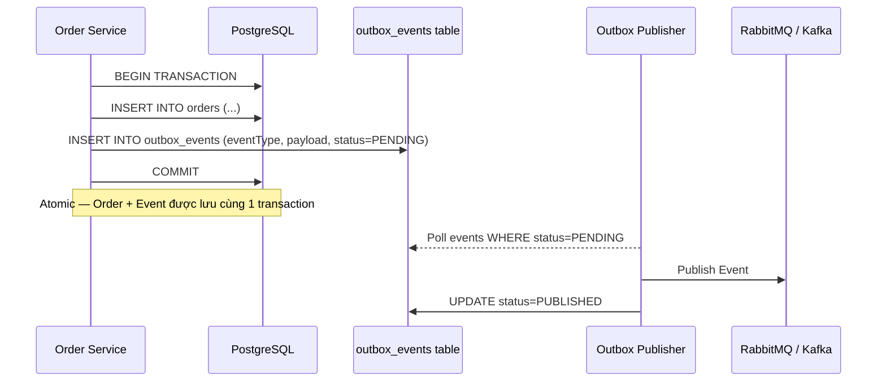
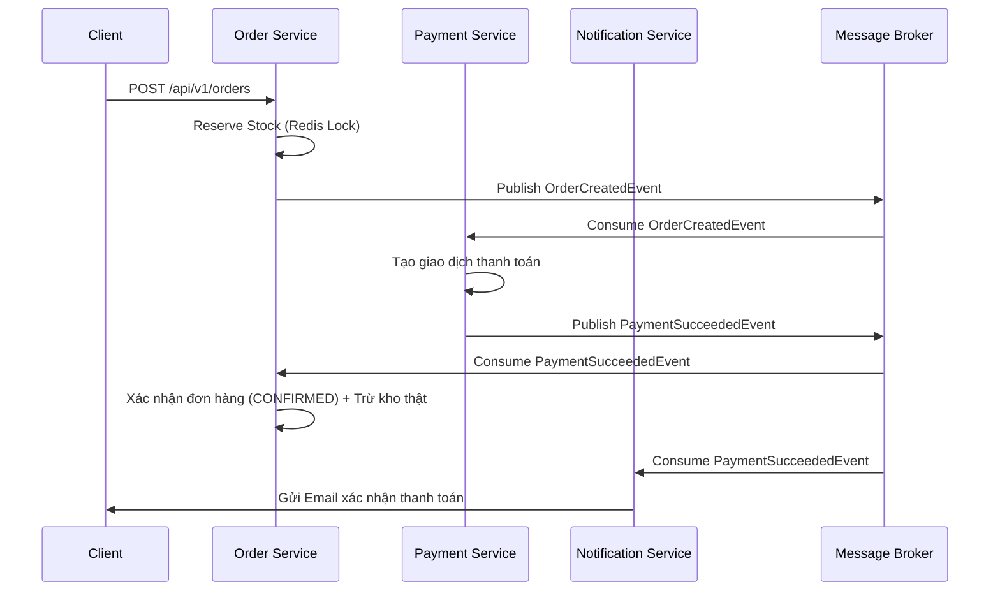
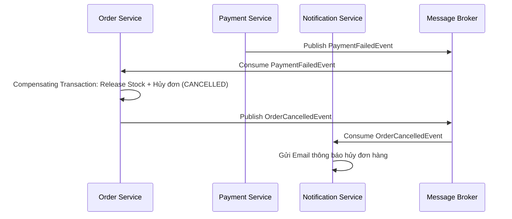

# Kiến trúc Hệ thống

> Tài liệu này mô tả kiến trúc mục tiêu. Sơ đồ implementation và sequence Day 14 ở [README](../README.md#2-phân-tích-kiến-trúc-microservices): RabbitMQ, PostgreSQL/MongoDB, gRPC Order → Product, giữ tồn bằng SQL transaction, payment giả lập và notification qua log. Redis lock, Elasticsearch, rate limiting và email/payment provider thật đề cập bên dưới chưa được nghiệm thu là chức năng hiện hữu.

## Nền tảng Thương mại Điện tử Đa kênh (Omnichannel E-Commerce)

### 1. Kiến trúc Tổng thể của Hệ thống
Nền tảng được thiết kế theo mẫu Kiến trúc Microservices. Kiến trúc này áp dụng mẫu **Database-per-Service** (Mỗi dịch vụ một cơ sở dữ liệu) để đảm bảo tính liên kết lỏng (loose coupling), khả năng mở rộng độc lập và thực thi nghiêm ngặt ranh giới giữa các dịch vụ. Tất cả các yêu cầu từ client bên ngoài được điều hướng qua **API Gateway**, trong khi giao tiếp giữa các dịch vụ (inter-service communication) sử dụng **gRPC** cho các lệnh gọi đồng bộ với độ trễ thấp và **Message Broker (Kafka/RabbitMQ)** cho các luồng xử lý bất đồng bộ, hướng sự kiện.

### 2. Các Hệ thống con & Microservices

| Tên Dịch vụ | Trách nhiệm Cốt lõi | Quyền sở hữu & Lưu trữ Dữ liệu |
|--------------|-----------------------|--------------------------|
| **API Gateway** | Điểm truy cập duy nhất, Giới hạn tốc độ (Rate limiting), Xác thực JWT, Điều hướng yêu cầu. | *Không có (Stateless - Phi trạng thái)* |
| **Identity & User Service** | Hồ sơ người dùng, Đăng ký, Phân quyền RBAC, Cấp phát JWT. | **PostgreSQL / MySQL** |
| **Product Catalog Service** | Chi tiết sản phẩm, Danh mục, Thương hiệu, SKU, Tìm kiếm toàn văn (Full-text Search). | **MongoDB** (Sản phẩm) + **Elasticsearch** (Chỉ mục tìm kiếm) |
| **Order & Inventory Service** | Xử lý đơn hàng, Quản lý trạng thái (Chờ xử lý -> Hoàn thành), Giữ kho theo thời gian thực, Distributed Locks (Khóa phân tán). | **PostgreSQL** (Đơn hàng/Tồn kho) + **Redis** (Distributed Lock/Redlock) |
| **Payment & Billing Service** | Tích hợp cổng thanh toán bên ngoài (Stripe, VNPay, v.v.), Xử lý Webhook, Đối soát tài chính. | **PostgreSQL** (Giao dịch) |
| **Notification Service** | Gửi Email, SMS và Push notification dựa trên các sự kiện của hệ thống. | **Redis / MongoDB** (Hàng đợi tin nhắn/Nhật ký) |

### 3. Sơ đồ Tương tác Thành phần

```mermaid
flowchart LR
    %% Clients
    Client[Web/Mobile Clients]
    
    %% API Gateway
    Gateway[API Gateway]
    
    %% Microservices
    Auth[Identity & User Service]
    Catalog[Product Catalog Service]
    Order[Order & Inventory Service]
    Payment[Payment & Billing Service]
    Notify[Notification Service]
    
    %% Message Broker
    MQ[(Message Broker \n Kafka / RabbitMQ)]
    
    %% External
    ExtPayment[Cổng Thanh toán Bên ngoài]
    
    %% Synchronous Flows
    Client -->|HTTPS / REST| Gateway
    Gateway -->|REST / gRPC| Auth
    Gateway -->|REST| Catalog
    Gateway -->|REST| Order
    Gateway -->|REST| Payment
    
    Order -->|gRPC < 5ms \n (Kiểm tra kho đồng bộ)| Catalog
    Payment -->|HTTPS| ExtPayment
    ExtPayment -->|Webhook| Payment
    
    %% Asynchronous Flows
    Order -.->|Publish Event| MQ
    Payment -.->|Publish Event| MQ
    
    MQ -.->|Consume| Notify
    MQ -.->|Consume| Payment
    MQ -.->|Consume| Order
```

### 4. Outbox Pattern (Đảm bảo độ tin cậy của Sự kiện)

Để đảm bảo sự kiện không bị mất khi Message Broker tạm thời ngắt kết nối, hệ thống áp dụng **Outbox Pattern**:



- **Bảng `outbox_events`** nằm trong cùng database với `orders` (PostgreSQL), đảm bảo tính atomic.
- **Outbox Publisher** là một background scheduler (Spring `@Scheduled`) polling định kỳ để đẩy event chưa gửi lên MQ.
- Nếu MQ bị lỗi, event vẫn an toàn trong DB và sẽ được retry khi MQ phục hồi.

---

### 5. Saga Pattern — Luồng Giao dịch Phân tán

Hệ thống sử dụng **Saga Choreography** (hướng sự kiện) để quản lý giao dịch trải dài nhiều service.

#### Happy Path (Thành công):



#### Compensation Path (Thất bại — Thanh toán lỗi):


