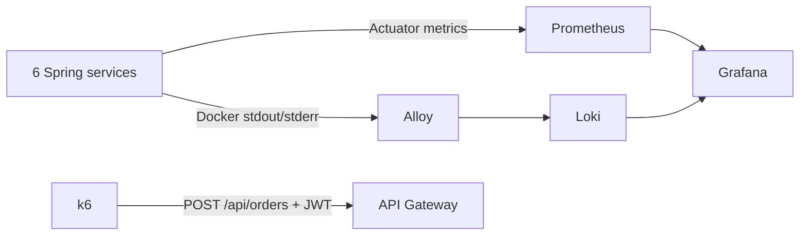

# Day 13 — Monitoring và Load Test

## Phạm vi

Prometheus đã scrape sáu service qua `/actuator/prometheus`; Day 13 bổ sung
histogram HTTP, dashboard tự provision, log tập trung và k6 kèm báo cáo tồn kho.
Giữ Java 17, các dependency Micrometer/Actuator hiện có và các API nghiệp vụ.



Alloy thay Promtail trong yêu cầu logging của SRS vì
[Promtail đã hết hỗ trợ ngày 02/03/2026](https://grafana.com/docs/loki/latest/send-data/promtail/).
Collector dùng [Docker discovery và loki.source.docker](https://grafana.com/docs/alloy/latest/reference/components/loki/loki.source.docker/)
để chỉ lấy log các container có label `ecommerce.logs=true`.
Không cần thay đổi cách ghi log của ứng dụng hoặc cài Docker logging plugin.

## Khởi động và kiểm tra

Chuẩn bị `.env` theo README, sau đó:

```bash
docker compose up -d --build
docker compose ps
```

Prometheus (`http://localhost:9090/targets`) phải có sáu application target **UP**.
Grafana (`http://localhost:3000`) dùng `GRAFANA_ADMIN_USER` và
`GRAFANA_ADMIN_PASSWORD` từ `.env`. Folder **E-Commerce** chứa dashboard
**E-Commerce — Monitoring & Logs** (`/d/ecommerce-overview`).
Datasource Prometheus và Loki được nạp từ `infrastructure/grafana/provisioning`.
Nếu volume Grafana đã được khởi tạo, password admin vẫn là password đã lưu trong
volume; biến môi trường chỉ có tác dụng khi tạo tài khoản admin lần đầu.

| Panel | Dữ liệu |
| --- | --- |
| Service UP / DOWN | `up`: trạng thái scrape; không thay thế kiểm tra readiness |
| Process CPU | CPU sử dụng bởi JVM của từng service |
| System CPU | CPU hệ thống mà mỗi JVM quan sát |
| JVM RAM | Tổng bộ nhớ heap + nonheap; không phải toàn bộ RAM host/container RSS |
| Requests/s | Tốc độ HTTP theo service, bỏ request `/actuator` |
| HTTP 2xx / 4xx / 5xx | Tốc độ response của từng nhóm status |
| Response time | p95 từ histogram và độ trễ trung bình |
| Service logs | Log từ Loki theo bộ lọc service |

Đợi khoảng hai chu kỳ scrape (30 giây) và tạo request để các panel HTTP có dữ liệu.
`application` tag được thêm cho metrics và histogram bật cho `http.server.requests`.
Không cộng RPS của gateway và backend để tính RPS client vì cùng một request được
đo tại cả hai nơi.

Trong Grafana Explore, chọn Loki và thử:

```logql
{job="ecommerce", service_name="order-inventory-service"}
{job="ecommerce", service_name="order-inventory-service"} |~ "ERROR|WARN"
```

Alloy gộp stack trace Java bằng multiline stage, giữ offset trong `alloy_data`.
Loki lưu trên filesystem trong `loki_data`, retention 7 ngày.
Docker log của service được xoay vòng 3 file, tối đa 10 MB mỗi file.

Prometheus và Grafana chỉ bind `127.0.0.1` ở cả hai Compose. Loki và Alloy không
publish port ra host. Trên VPS, truy cập qua SSH tunnel từ máy cá nhân:

```bash
ssh -L 3000:127.0.0.1:3000 -L 9090:127.0.0.1:9090 user@vps
```

Alloy cần quyền đọc Docker API qua socket; socket mount `:ro` không hạn chế các
method API. Chỉ dùng cấu hình collector này trên Docker host do nhóm quản lý.

## Kịch bản k6

Runner cần Python 3.10+ và Docker Compose; k6 chạy trong container, không cần cài
k6 hoặc thư viện Python. Chạy từ repository root trên máy có Compose stack:

```bash
python infrastructure/k6/run-load-test.py
```

Mặc định chạy 500 request/s trong 30 giây, sau đó 1000 request/s trong 30 giây.
Mỗi iteration chỉ POST một đơn, dùng
[constant-arrival-rate](https://grafana.com/docs/k6/latest/using-k6/scenarios/executors/constant-arrival-rate/).
Login và kiểm tra product chạy một lần trong setup, không tính vào order RPS.
Tải tạo HTTP `201` mới được tính là đơn tạo thành công; đơn `CONFIRMED` được đo
riêng sau khi Saga xử lý. Mọi response khác, gồm 400/401/5xx, đều là lỗi của bài
đo capacity này. Không coi hết hàng là thành công.

Ví dụ smoke test và tùy chỉnh:

```bash
python infrastructure/k6/run-load-test.py --rates 5 --duration 5
python infrastructure/k6/run-load-test.py --rates 500 1000 --duration 60 --settle-timeout 300
python infrastructure/k6/run-load-test.py --compose-file docker-compose.production.yml --base-url http://localhost:8080
```

`--base-url` là URL gateway từ host để tạo fixture; `--container-base-url` là URL
gateway từ container k6 (mặc định `http://api-gateway:8080`). Có thể đổi cả hai
sang HTTPS để đo qua Nginx. Dùng `--env-file` nếu Compose không dùng `.env`.

Runner tạo tài khoản, category và product qua các API hiện có. Mỗi lượt có SKU
mới và lượng stock `rate * duration + 100`, với một item có quantity 1 mỗi đơn.
Giá fixture là 1000 VND để mock payment hiện tại đi nhánh success (`<= 10000`).
Runner chờ Product nhận xác nhận đồng bộ inventory qua RabbitMQ, rồi đọc snapshot
ở **Order DB** bằng `psql` trong container postgres. Không cần INSERT fixture.
Service không truy cập database của service khác. Runner không reset stock,
không xóa dữ liệu cũ; fixture được giữ để kiểm tra sau test.
Product API yêu cầu ADMIN cho thao tác ghi. Thiết lập FIXTURE_ADMIN_EMAIL và
FIXTURE_ADMIN_PASSWORD theo [hướng dẫn fixture](security-and-cancellation.md);
runner dùng ADMIN tạo catalog và tài khoản khách riêng để đo luồng đặt đơn.

## Đánh giá và báo cáo

Mặc định fail nếu error rate >= 1%, p95 >= 2000 ms, có dropped iterations hoặc
không tạo được đơn. Các ngưỡng là tiêu chí thử tải cấu hình được, không phải SLA
đã được chứng minh. Đổi bằng `--p95-limit-ms`, `--max-error-rate` nếu cần.
VU mặc định preallocate bằng RPS, max bằng 2 lần RPS. Có thể dùng
`--pre-allocated-vus` và `--max-vus` khi máy tạo tải đủ tài nguyên.

Mỗi lượt tạo ba file dưới `infrastructure/k6/results/`:

- `day13-...-k6.json`: RPS, p95, error rate, số HTTP 201, dropped iterations, thresholds.
- `day13-...-report.json`: thêm snapshot trước/sau và kiểm tra tồn kho.
- `day13-...-report.md`: bảng kết quả có thể chia sẻ sau khi kiểm tra nội dung.

RPS báo cáo = số POST hoàn tất / thời gian tải cấu hình; các request còn chạy
được chờ tối đa 30 giây sau giai đoạn phát tải. Dropped iterations phản ánh mức
tải generator không phát được. Vì vậy cần đọc cả RPS thực tế và dropped
iterations trước khi kết luận đạt 500/1000 RPS.

Runner chờ tối đa 120 giây cho Saga và ghi riêng `totalStock`, `reservedStock`,
`availableStock`, số đơn PENDING/CONFIRMED/CANCELLED. Kiểm tra:

- Tồn kho không âm; `total = available + reserved`.
- `reserved = số đơn PENDING` vì mỗi đơn giữ một item.
- `initial - total = số đơn CONFIRMED`.
- `CONFIRMED + PENDING <= initial` và số HTTP 201 khớp số đơn trong DB.

Exit code khác 0 nếu k6 fail, tồn kho sai hoặc Saga chưa xử lý hết trong timeout.
Báo cáo vẫn được ghi khi k6 fail threshold. Không có số liệu giả định thay cho
lần chạy thật. Nếu setup thất bại và k6 không xuất summary, runner báo lỗi.

Baseline Day 13 dùng Outbox 20 event mỗi chu kỳ khoảng 1 giây ở cả Order/Payment.
Bản [tối ưu sau Day 13](performance-optimization.md) dùng mặc định 200 event/50 ms,
confirm theo lô và UPDATE tồn kho nguyên tử. Một SKU duy nhất vẫn cố ý tạo tranh chấp
khóa hàng PostgreSQL. Runner chờ fixture tải cũ và Order Outbox xử lý hết trước mỗi
mức; nếu hết timeout thì không bắt đầu tải mới. Báo cáo ghi thêm thời gian chờ Saga.

## Kiểm tra cấu hình và CI

```bash
docker compose --env-file .env.example config --quiet
docker compose --env-file .env.example -f docker-compose.production.yml config --quiet
python -m unittest discover -s infrastructure/k6 -p "test_*.py"
```

CI kiểm tra cả Compose, Prometheus, Loki, Alloy và logic đối chiếu tồn kho.
Không chạy tải 500/1000 RPS trong CI. Các kết quả chạy thật và giới hạn nằm trong
[báo cáo Day 13](day13-performance-report.md).
